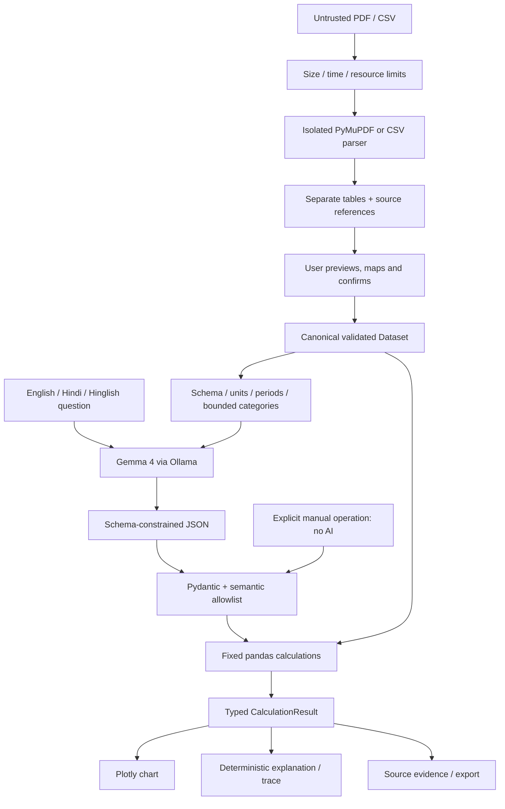

# How CampusPulse produces an answer

**Gemma interprets. Python calculates. Evidence supports the answer.** The calculation engine is independent of Streamlit, Ollama and network access.



## Ingestion

`ingestion.py` accepts bounded bytes and sanitizes filenames only for display/provenance. Parsing runs in a spawned subprocess with a wall-clock deadline, plus CPU and additional virtual-memory limits on Linux. A deadline terminates the process. Uploaded filenames never become filesystem paths. Interprocess objects are generated by trusted parser code; uploaded bytes are never loaded as Python/pickle objects.

PDF content must have a signature and open with PyMuPDF. Encrypted/oversized documents fail early. Each page provides real text and detected tables. Grid detection is preferred with a bounded text-alignment fallback. Missing/duplicate headers receive generic labels and a warning. Repeated header rows are excluded; multiline cells are whitespace-normalized. Actual page/table/row positions are preserved. No table means an actionable error; no text/tables explains the OCR limitation.

Separate tables are not merged. Matching headers alone do not establish compatible meaning, units or periods. The sample holds all 30 observations in one table; whole-report analysis across separate tables requires an explicitly consolidated CSV.

CSV uses the standard reader before pandas to preserve duplicate-header detection and physical line numbers. It handles UTF-8/BOM and bounded delimiter detection with a manual override. Malformed quoting/widths, missing headers, unexpected content and oversized cells fail with actionable errors. Source rows are physical ending lines, including multiline quoted records.

## Dataset normalization

`normalization.py` suggests deterministic aliases but UI confirmation is required. Core columns are building, month and electricity in kWh. Optional metrics have fixed units. Wh/MWh and ambiguous numeric formats are rejected rather than relabelled. Original cells remain in `raw_*` columns alongside normalized values.

Periods become validated `YYYY-MM` strings. Bare months require an explicit year; ISO daily dates map to months with a warning. The observation grain is **one building per month**. Duplicate keys stop validation; no guessing about daily readings or submeter totals occurs.

Missing values remain NaN, distinct from zero. Missing periods/observations generate caveats without imputation. `Dataset` holds the frame, typed column/unit definitions, classification and caveats. Source row IDs remain stable within the selected table. New files/table selections invalidate old answers.

## Model planning

`gemma_client.py` calls the official Ollama client's `list()` and `chat()`. It checks the exact configured `gemma4:<tag>`, supplies `AnalysisPlan.model_json_schema()` as the constrained-output format, and uses bounded response/request limits. No automatic download, substitute family or fabricated response exists.

The planning payload includes question, previous validated plan, column schema/units, available months, current date/timezone and up to 100 distinct category labels per field. Explanations receive computed result facts and caveats in a separate request. No full conversation transcript is sent. It excludes document text, bytes, filenames and numeric observation rows. Category lists may be sensitive; truncation is disclosed to the model. Remote processing requires session consent. Local means local to the app server.

Prompts describe English/Hindi/Hinglish, explicit averages, calendar-relative periods and unsupported causal claims. Language interpretation is not guaranteed by a valid JSON response. The real-model suite checks downstream answers, while mocked tests only validate integration mechanics/errors. Live inference was unavailable during implementation.

## Plan validation and safety

Pydantic forbids extra fields and bounds intents, aggregations, filters and list sizes. `validation.py` checks columns, grouping, dates, numeric types and operation consistency. Provenance/raw columns cannot be queried by model plans. Unknown operations and code fields fail validation. Rates cannot be summed.

The engine executes fixed functions, never generated Python, SQL, shell commands, imports or expressions. Embedded document instructions cannot expand the allowlist. Conservative question guards also refuse common waste claims and prevent a cost question being answered as consumption. These guards are not a complete semantic proof: a valid plan may still misinterpret a question. The validated plan is summarized in plain language; model JSON stays internal.

## Calculation and missing data

The engine applies allowlisted filters, groupings, sum/mean/min/max/count, ranking, trend and comparison. Known missing metrics/periods/categories and empty selections yield unavailable results with no invented values or citations.

Sum uses `min_count=1`; an all-missing group is not zero. Count means observed numeric cells. Means explicitly use observations, monthly totals or building totals. Ranking retains ties at its cutoff. Trends insert null display gaps for absent months, never new measurements or evidence.

Comparison requires two distinct explicit periods. Python computes old/new values, absolute difference and percentage difference. Zero old values produce an undefined percentage; unequal observed-building populations generate a warning. Floating-point intermediate values are not rounded; display uses two decimals. Nonfinite/overflow results are refused. This is measurement analysis, not a financial ledger.

## Explanation, charts and evidence

`CalculationResult` includes status, plan, verified values, units, evidence, warnings, executed trace, chart type and comparison details. The engine chooses a chart for the executed operation; a model chart suggestion cannot force an inappropriate visualization. Plotly reads exactly the returned values, starts bar scales at zero and does not connect missing trend points. Unavailable answers have no chart.

Inline numerical formulas come from executed calculations and real citations, without user-facing JSON. A separate Gemma request composes explanatory prose using whole-fact placeholders. `explanations.py` rejects unknown placeholders, literal digits (including Devanagari) and supported number-word forms, then substitutes trusted labelled facts. The optional check suggestions are allowlisted and localized. This checks numerical provenance, not the truth of every qualitative phrase. If the model fails or introduces an unverified number, the answer remains available with a visibly labelled deterministic fallback.

Every source row carries filename, PDF page/table if applicable, source row and stable row ID. CSV pages remain null. Evidence is selected from real rows, not reconstructed by the model. Ranking includes the candidate population; comparisons include both periods. Unavailable answers assert no precise citation. CSV export neutralizes formula-leading labels without mutating source values.

## UI lifecycle and privacy

`app.py` stores uploads, extracted tables, confirmed data and the last six answers in session state. A replacement, different table, new confirmation or reset clears previous results. Parsed uploads are reused within the session, not cached across users. No database or upload-file persistence is used.

The sidebar shows exact model and endpoint classification. Remote consent describes the payload. A cloud-hosted application is not running exclusively on the user's laptop. Logs contain error categories, not uploaded content. Reset releases references without promising forensic memory erasure; hosting policy still applies.

## Module map and remaining limits

| Module | Role |
|---|---|
| `config.py`, `models.py` | Central configuration and typed boundaries |
| `ingestion.py`, `pdf_parser.py`, `csv_parser.py` | Bounded parsing and citations |
| `normalization.py`, `validation.py` | Schema meaning, units and plan validation |
| `gemma_client.py`, `question_planner.py` | Model readiness, prompt and structured planning |
| `analysis_engine.py` | Network-free math and grounded explanation |
| `visualization.py`, `evidence.py` | Verified charts and source export |
| `app.py` | Review, consent, chat and session lifecycle |

Tests use real parser fixtures and Streamlit widgets, separate mocked model tests and opt-in live inference. OCR, cross-table merging, extra resource schemas, production authentication and a real-world model accuracy evaluation remain outside this MVP. The exact candidate model tag and live Gemma behavior remain unverified until the documented external prerequisites are supplied.


## Overview, student denominators, anomalies and scenarios

The overview computes totals, highest-building ties and a short annotated trend before the first question. Rankings retain all candidates for winner-highlighted charts; period comparisons retain a separate verified building/month breakdown for grouped bars. Overall changes remain computed from the full selected observations.

`per_student` computes sum(kWh) / sum(monthly student counts) for each eligible building. A building with any missing/zero count or missing electricity in the selected period is excluded, with a named warning. For several months the unit is **kWh/student-month**, not kWh per unique student. Sample Library counts are intentionally absent in both CSV and PDF. The data confirmation screen explicitly asks users to map occupancy as student counts.

`scenario` requires a bounded reduction percentage and exact target building names. Period filters select the baseline population; target buildings are separate from filters so unchanged buildings remain in the campus total. Savings = target usage × reduction/100; new campus total = measured campus total − savings. These are conditional calculations, never predictions.

Anomaly flags use only the building's own prior history: at least three earlier valid adjacent-month percentage changes, a positive prior value, and a deviation from the prior median exceeding max(20 percentage points, 3 × 1.4826 × prior median absolute deviation). Gaps/zero baselines never become fabricated changes. Each flagged observation retains source references and says **cause unknown**. With insufficient history, no flag is not proof of normality.

Follow-up buttons pass their own parent answer's plan; typed follow-ups use the latest planned answer. Dataset replacement, table changes, reconfirmation and history reset invalidate context. Model calls are staged as planning, calculation and explanation, with elapsed wall time stored per answer.

`reporting.py` uses the already-installed PyMuPDF to generate a self-contained, single-page PDF with a vector chart, result, formulas, citations and caveats. It escapes untrusted labels and requires no hosted renderer. Large results are explicitly abbreviated (up to ten chart categories, four working lines and six caveats); full working remains in the app and all source rows are in the CSV. Reports are session-local and do not trigger inference again.

PNG export rasterizes that same report at 144 dpi, preserving its chart, working and caveats. PDF and PNG bytes are cached in the session entry; downloads do not rerun the app. A PNG failure leaves the PDF, CSV and calculated answer available. Presentation helpers in `ui.py` escape all dynamic text before adding styles. The UI uses native Streamlit controls, a responsive three-step guide and analysis-specific manual controls; calculation and model-validation code is independent of styling.


## Multi-source architecture (October 2026)

```
Up to MAX_FILES PDF/CSV uploads
  -> independent bounded ingestion / preview / explicit mapping and confirmation
  -> SourceEntry(source_id, filename, display_label, Dataset) [Streamlit session]
  -> combine_sources: concatenated frame with source_id + source_label
  -> Python plan/semantic validator (source allowlist + existing metrics)
  -> Gemma constrained JSON plan (question, schema, IDs/labels, prior validated plan only)
  -> Python calculate() (scoped sources, compare_sources, per-source trends)
  -> Plotly / human-readable formula / source-provenance CSV / answer PDF, PNG
```

`campuspulse/multi_source.py` maintains an immutable-identity source registry and combines **confirmed** datasets while preserving source provenance. File names are sanitized and IDs de-duplicated. Original uploaded bytes are discarded after parsing. Cross-source duplicate building/month pairs remain separate; only within-source duplicates are errors. Any overlapping aggregate is flagged as potentially double-counted.

`campuspulse/source_analysis.py` computes source comparisons. Source A is the first selected/confirmed source; subsequent source values are compared independently with differences and undefined zero-baseline percentages. Per-student comparisons require positive complete occupancy. Source-specific trend lines never fill missing months with invented zeros. Changes in the selection, labels, file removal or rate invalidate the prior answer history.

The planner's `sources` list contains only selected source IDs, and source descriptions contain no raw rows. Category names are only schema labels, never prompts to execute code. All arithmetic and source references come from validated Python operations. The new frontend palette is applied through `.streamlit/config.toml`, `campuspulse/ui.py`, `campuspulse/visualization.py`, and `campuspulse/reporting.py`.

The Gemini provider is **hosted** and is not labelled as local. Ollama remains a separate configured endpoint. Presence of a Gemini API key is not proof of successful inference; remote processing requires consent in the UI.


## Multi-source data flow (current build)

```text
Streamlit multi-file picker (up to MAX_FILES; never persist upload bytes)
  -> independent CSV/PDF parse + preview + column mapping + confirmation
  -> SourceEntry(source_id, source_label, per-file validated Dataset)
  -> combine_sources() [keeps original provenance; *does not* merge overlapping rows]
  -> apply_custom_tariff() [optional shared, user-set ₹/kWh]
  -> selected sources -> schema_context (names, periods and column metadata only)
  -> Gemma planning (JSON only) -> strict Pydantic + semantic validation
  -> Python calculate() or compare_sources() / source_trend()
  -> human-readable trace, per-source Plotly, and source-aware PDF/PNG/CSV evidence
```

`source_id` uniquely identifies the report throughout the session; `source_label` is
editable presentation metadata. `row_id` is namespaced with the source ID. The
uniqueness key is `(source_id, building_name, month)`, while original page/table/
source row/raw values remain unchanged. The model never receives source rows or
raw uploads. All-files sums require care with overlapping sources; a duplicate
building/month from two files is not an error, but is **not** a new independent
reading either. Comparisons calculate each file separately and report change
relative to the reference (first selected) source, with undefined percentages
when baseline is zero.

**Per-source concerns:** mismatched building names produce tentative fuzzy-match
*warnings only*, not a hidden rename; optional missing columns and periods are
reported; unit choices are checked per upload; global flat-rate estimates use
one rate for all files. For data that require a building-name merge, correct
the source files and confirm the remapped data explicitly. No OCR/database.
