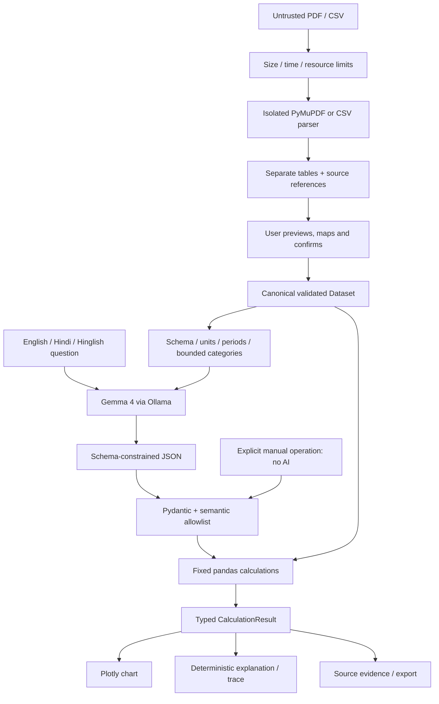

# How CampusPulse produces an answer

**Gemma interprets. Python calculates. Evidence supports the answer.** The calculation engine is independent of Streamlit, Ollama and network access.

## Ingestion

`ingestion.py` accepts bounded bytes and sanitizes filenames only for display/provenance. Parsing runs in a spawned subprocess with a wall-clock deadline, plus CPU and additional virtual-memory limits on Linux. A deadline terminates the process. Uploaded filenames never become filesystem paths. Interprocess objects are generated by trusted parser code; uploaded bytes are never loaded as Python/pickle objects.

PDF content must have a signature and open with PyMuPDF. Encrypted/oversized documents fail early. Each page provides real text and detected tables. Grid detection is preferred with a bounded text-alignment fallback. Missing/duplicate headers receive generic labels and a warning. Repeated header rows are excluded; multiline cells are whitespace-normalized. Actual page/table/row positions are preserved. No table means an actionable error; no text/tables explains the OCR limitation.

Separate tables are not merged. Matching headers alone do not establish compatible meaning, units or periods. The sample holds all 30 observations in one table; whole-report analysis across separate tables requires an explicitly consolidated CSV.

CSV uses the standard reader before pandas to preserve duplicate-header detection and physical line numbers. It handles UTF-8/BOM and bounded delimiter detection with a manual override. Malformed quoting/widths, missing headers, unexpected content and oversized cells fail with actionable errors. Source rows are physical ending lines, including multiline quoted records.

## Dataset normalization

`normalization.py` suggests deterministic aliases but UI confirmation is required. Core columns are building, month and electricity in kWh. Optional metrics have fixed units. Wh/MWh and ambiguous numeric formats are rejected rather than relabelled. Original cells remain in `raw_*` columns alongside normalized values.

Periods become validated `YYYY-MM` strings. Bare months require an explicit year; ISO daily dates map to months with a warning. The observation grain is **one building per month**. Duplicate keys stop validation; no guessing about daily readings or submeter totals occurs.

Missing values remain NaN, distinct from zero. Missing periods/observations generate caveats without imputation. `Dataset` holds the frame, typed column/unit definitions, classification and caveats. Source row IDs remain stable within the selected table. New files/table selections invalidate old answers.

## Model planning

`gemma_client.py` calls the official Ollama client's `list()` and `chat()`. It checks the exact configured `gemma4:<tag>`, supplies `AnalysisPlan.model_json_schema()` as the constrained-output format, and uses bounded response/request limits. No automatic download, substitute family or fabricated response exists.

The payload includes question, column schema/units, available months, current date/timezone and up to 100 distinct category labels per field. It excludes document text, bytes, filenames and numeric observation rows. Category lists may be sensitive; truncation is disclosed to the model. Remote processing requires session consent. Local means local to the app server.

Prompts describe English/Hindi/Hinglish, explicit averages, calendar-relative periods and unsupported causal claims. Language interpretation is not guaranteed by a valid JSON response. The real-model suite checks downstream answers, while mocked tests only validate integration mechanics/errors. Live inference was unavailable during implementation.

## Plan validation and safety

Pydantic forbids extra fields and bounds intents, aggregations, filters and list sizes. `validation.py` checks columns, grouping, dates, numeric types and operation consistency. Provenance/raw columns cannot be queried by model plans. Unknown operations and code fields fail validation. Rates cannot be summed.

The engine executes fixed functions, never generated Python, SQL, shell commands, imports or expressions. Embedded document instructions cannot expand the allowlist. Conservative question guards also refuse common waste/per-student claims and prevent a cost question being answered as consumption. These guards are not a complete semantic proof: a valid plan may still misinterpret a question. The plan remains visible for review.

## Calculation and missing data

The engine applies allowlisted filters, groupings, sum/mean/min/max/count, ranking, trend and comparison. Known missing metrics/periods/categories and empty selections yield unavailable results with no invented values or citations.

Sum uses `min_count=1`; an all-missing group is not zero. Count means observed numeric cells. Means explicitly use observations, monthly totals or building totals. Ranking retains ties at its cutoff. Trends insert null display gaps for absent months, never new measurements or evidence.

Comparison requires two distinct explicit periods. Python computes old/new values, absolute difference and percentage difference. Zero old values produce an undefined percentage; unequal observed-building populations generate a warning. Floating-point intermediate values are not rounded; display uses two decimals. Nonfinite/overflow results are refused. This is measurement analysis, not a financial ledger.

## Explanation, charts and evidence

`CalculationResult` includes status, plan, verified values, units, evidence, warnings, executed trace, chart type and comparison details. The engine chooses a chart for the executed operation; a model chart suggestion cannot force an inappropriate visualization. Plotly reads exactly the returned values, starts bar scales at zero and does not connect missing trend points. Unavailable answers have no chart.

Numerical explanations/formulas use deterministic templates, not free-form model numbers or causal claims. The trace records actual filters, group intermediate values, formulas and denominators; input rows and validated plans are visible.

Every source row carries filename, PDF page/table if applicable, source row and stable row ID. CSV pages remain null. Evidence is selected from real rows, not reconstructed by the model. Ranking includes the candidate population; comparisons include both periods. Unavailable answers assert no precise citation. CSV export neutralizes formula-leading labels without mutating source values.

## UI lifecycle and privacy

`app.py` stores uploads, extracted tables, confirmed data and the last six answers in session state. A replacement, different table, new confirmation or reset clears previous results. Parsed uploads are reused within the session, not cached across users. No database or upload-file persistence is used.

The sidebar shows exact model and endpoint classification. Remote consent describes the payload. A cloud-hosted application is not running exclusively on the user's laptop. Logs contain error categories, not uploaded content. Reset releases references without promising forensic memory erasure; hosting policy still applies.

## Module map and remaining limits

| Module | Role |
|---|---|
| `config.py`, `models.py` | Central configuration and typed boundaries |
| `ingestion.py`, `pdf_parser.py`, `csv_parser.py` | Bounded parsing and citations |
| `normalization.py`, `validation.py` | Schema meaning, units and plan validation |
| `gemma_client.py`, `question_planner.py` | Model readiness, prompt and structured planning |
| `analysis_engine.py` | Network-free math and grounded explanation |
| `visualization.py`, `evidence.py` | Verified charts and source export |
| `app.py` | Review, consent, chat and session lifecycle |

Tests use real parser fixtures and Streamlit widgets, separate mocked model tests and opt-in live inference. OCR, cross-table merging, extra resource schemas, production authentication and a real-world model accuracy evaluation remain outside this MVP. The exact candidate model tag and live Gemma behavior remain unverified until the documented external prerequisites are supplied.
