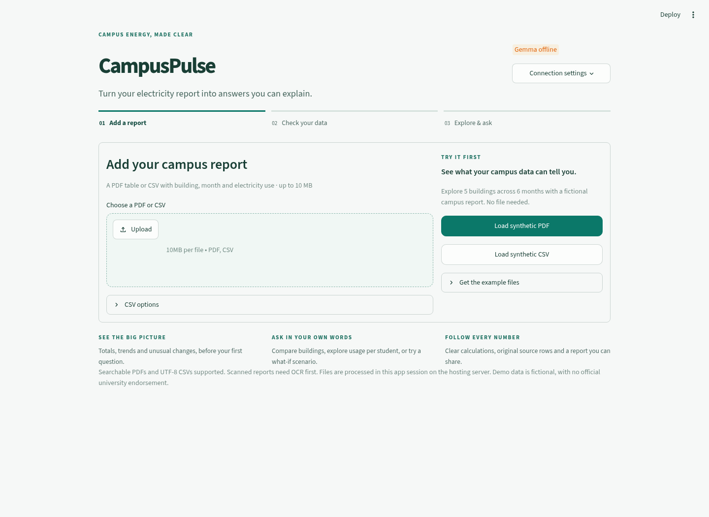
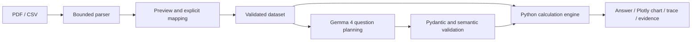

# CampusPulse

**AI-Powered Community and Environmental Data Intelligence**

Upload a campus electricity PDF or CSV, ask a question, inspect a chart, and trace the answer to its source.

Built for **Hacktoberfest Hackday 2026 · Track 1 — Best Use of Gemma 4 · PS 03 — Community and Environmental Data Intelligence**. The pilot context is IIMT University, Meerut, India. This independent prototype claims **no university endorsement or official resource data**.

> **SYNTHETIC DEMONSTRATION DATA:** all bundled measurements are fictional. The sample PDF and CSV contain the same 30 observations.

## Implementation status

The application implements real PDF extraction, CSV ingestion, explicit schema confirmation, numerical analysis, Plotly charts, evidence export, and constrained Gemma question planning through the official Ollama client.

**Live Gemma inference has not been verified here.** This implementation environment has no Ollama service or model installed. Official Ollama GitHub documentation confirms Gemma 4 support, but network policy blocked the model catalog/registry. Therefore `gemma4:e2b` is a **candidate configuration whose specific tag availability is unverified**, not a claim that it has been installed or tested. Verify the tag before downloading/presenting. The application checks the exact installed tag and never substitutes another model.

Manual analysis is labelled **no AI** and does not satisfy the Gemma requirement. See [VALIDATION.md](VALIDATION.md), [DEMO.md](DEMO.md) and [ARCHITECTURE.md](ARCHITECTURE.md).

## Problem and solution

Campus resource reports often hide missing observations, unfair comparisons and unexplained totals. CampusPulse converts a table into a reviewed dataset, asks Gemma to select a constrained operation, then lets Python calculate the result. The chart, explanation, formula and source evidence all refer to the same computation.

## Features



- Main-screen PDF/CSV upload with a three-step guide, active-file summary, and responsive layout. After confirmation: totals, building counts, covered months, highest building, a trend and a synthetic-data badge.
- Separate PDF table selection, row preview, column mapping, explicit units and confirmation.
- CSV UTF-8/BOM support, delimiter detection/override and physical line references.
- Rankings with ties, chronological trends, group/period comparisons, totals, min/max/count and defined averages.
- Missing values/periods, zero denominators, duplicate observations and partial-coverage checks.
- English, Hindi and Hinglish planning prompts with constrained JSON; real language quality needs live validation.
- Visible plain-language working and caveats beneath every answer; no user-facing JSON. Rankings highlight winners, comparisons show grouped building bars and change cards, and trends mark high/low months.
- Student-normalized usage with missing-denominator exclusions, history-based anomaly flags and conditional what-if savings.
- Follow-up questions inherit a validated plan; each answer offers three follow-up buttons. Planning/calculation stages and measured response time stay visible. Preset buttons run explicit calculations without AI, including the month with highest usage.
- Guarded Gemma explanations are optional: the calculated answer appears first, then **Explain with Gemma · optional** requests prose (Hindi for Hindi questions). PDF/PNG reports and spreadsheet-safe evidence CSV remain available without that extra call.
- Exact model status, local/remote disclosure and remote-processing consent.
- Clearly labelled manual mode for disconnected development, without fake AI answers. Controls adapt to the selected analysis; comparison periods and what-if percentages appear only when needed.

## Architecture and stack



Python 3.11+ compatible source, tested on **Python 3.12.14**. Streamlit, pandas, NumPy, PyMuPDF, Plotly, Pydantic 2, the official `ollama` client, python-dotenv, pytest and Ruff. No database or separate API service is needed.

## Installation and launch

Use the existing checkout in a cloud task; tasks are already isolated, so no extra Git worktree is needed.

Linux/macOS, from the repository root:

```bash
python3 -m venv .venv
source .venv/bin/activate
python -m pip install -r requirements-lock.txt
cp -n .env.example .env
python -m streamlit run app.py
```

Windows PowerShell:

```powershell
py -3.12 -m venv .venv
.\.venv\Scripts\python.exe -m pip install -r requirements-lock.txt
if (!(Test-Path .env)) { Copy-Item .env.example .env }
.\.venv\Scripts\python.exe -m streamlit run app.py
```

The lock pins the tested environment, including developer tools. Runtime ranges are in `requirements.txt`; `requirements-dev.txt` adds testing/lint tools. To intentionally refresh dependencies, install the development requirements, run the tests, and review an updated lock. No model is downloaded during Python installation. Local development requires no credentials.

The sample artifacts are included. Regenerate them with:

```bash
python -m scripts.generate_demo_data
```

## Ollama and Gemma 4 setup

Install a current Ollama release following the [official project](https://github.com/ollama/ollama) and its [platform instructions](https://docs.ollama.com/quickstart). Its README documents Gemma 4 and the Python client. Check the [official Gemma 4 tag catalog](https://ollama.com/library/gemma4/tags) and choose a tag that fits your hardware. The implementation environment could not verify the candidate `gemma4:e2b` against that catalog.

Start Ollama if its desktop/background service is not already running:

```bash
ollama serve
```

In another terminal, **after verifying the candidate tag and choosing to download it**:

```bash
ollama pull gemma4:e2b
ollama list
python -m scripts.check_model
```

Model downloads can be multiple gigabytes. The application never downloads them automatically. Configure the exact installed tag. Gemma, Gemma 2, Gemma 3/3n and Gemma 4 tags are accepted when explicitly selected, with no silent substitution. **Gemma 4 is still required for the hackathon demonstration**; selecting `gemma2:2b` for local experimentation does not satisfy that requirement. Compatibility with the client is not a claim of verified live language quality.

```dotenv
OLLAMA_HOST=http://localhost:11434
OLLAMA_MODEL=gemma4:e2b
OLLAMA_TIMEOUT_SECONDS=45
OLLAMA_NUM_PREDICT=512
APP_TIMEZONE=Asia/Kolkata
```

Restart Streamlit after changing `.env`. Open **Connection settings → Refresh connection**. An available model is not proof of inference: type a question or run the live integration tests to demonstrate actual Gemma use. Preset buttons intentionally do not call the model.

For slow laptops, start with the quick calculations. Typed questions make one planning call; explanations require a separate click. The default output budget is 512 tokens for a plan and at most 256 for an explanation, with a 45-second read timeout and a 10-minute model keep-alive. Existing `.env` timeout values take precedence, so update them explicitly. Smaller budgets reduce generated work but can cut short complex requests; such responses are rejected without an automatic retry. These settings do not guarantee a particular hardware speed.

Run `ollama ps` on the laptop while a request is active to inspect CPU/GPU use. Answers display Ollama's model-loading, prompt-processing and generation durations when available. A long model-load phase suggests cold starts; generation speed depends on hardware and model size. No GPU throughput was measured in this cloud checkout.

“In which month the elctricity bill was higest” is checked before inference when the file has no cost column: the app explains that bill amounts are missing. For the synthetic sample, **Month with highest electricity use** returns June 2026, **21,950 kWh**. That is consumption, not a rupee bill.

Remote Ollama is supported through `OLLAMA_HOST`. Use a trusted, secured endpoint; the app requires consent before transmitting questions/schema to a remote server. It does not implement hosted-provider authentication adapters, and the inference client does not inherit ambient HTTP proxy settings. Configure an endpoint it can reach directly.

Restricted cloud environments may require `ollama.com`, `docs.ollama.com`, `registry.ollama.ai`, official release artifact hosts, or the configured remote endpoint in their network settings. A saved draft does not apply network changes to the running instance.

## Supported data

Minimum schema:

```csv
building_name,month,electricity_kwh
Academic Block A,2026-05,5200
Academic Block A,2026-06,5600
```

These example measurements are synthetic. Deterministic aliases include Building, Block, Hostel, Period, Consumption, Units Consumed and kWh. Ambiguous matches require explicit mapping. Optional columns: `building_id`, `department`, `occupancy` (student counts when using per-student analysis), `tariff_inr_per_kwh` (INR/kWh), `electricity_cost_inr` (INR). Tariff-to-cost derivation is not implemented; no tariff is assumed.

- Periods: `2026-06`, `2026-06-15`, `June 2026`, `Jun 2026`. Bare month names require a user-specified year. Ambiguous numeric date formats are rejected.
- One observation per building/month. Duplicate keys stop validation rather than being silently summed or discarded. Daily/submeter datasets need explicit upstream aggregation.
- kWh is required. Wh/MWh are never silently relabelled; convert them explicitly before uploading.
- Decimal numbers and conventional comma thousands separators are supported. Decimal-comma and Indian-grouping formats need explicit preprocessing. Negative/nonfinite measurements are rejected.
- Blank, NA, N/A, null, nan, em-dash and dash numeric cells remain missing. Zero remains a measurement. All-missing sums are unavailable.
- Observed-value aggregates are not estimates of absent usage. Warnings identify partial building/month coverage.

### PDF support and limits

Searchable PDFs with clear structured tables, especially grid tables, are supported. PyMuPDF detects tables with a bounded aligned-text fallback. Review extraction before confirming. No CSV is secretly substituted for an uploaded PDF.

Scanned/image-only PDFs, encrypted files and narrative reports without tables are unsupported. OCR is not included. Multiple tables/pages are detected and kept separate; **one selected table is analyzed at a time**. Consolidate a report split across pages into a CSV for report-wide analysis.

Defaults: 10 MB upload, 30 pages, 30 tables, 20,000 extracted rows, 40 columns, 250,000 cells, 500 characters/cell and a 25-second parser deadline. Linux workers also have CPU limits and a 1,536 MB additional virtual-memory allowance. Other platforms retain byte/row/time limits, without an equivalent native memory cap. The independent Streamlit upload cap in `.streamlit/config.toml` must be changed alongside `MAX_UPLOAD_MB` if needed.

## Try the demonstration

1. Launch the app and confirm Gemma connectivity, or explicitly choose the manual backup.
2. Upload `data/campus_electricity_sample.pdf` or select **Load synthetic PDF**.
3. Preview the table, confirm mappings and kWh, check the review checkbox and select **Confirm dataset**.
4. Ask “Which building consumed the most electricity in June 2026?”
5. Ask “Compare May 2026 and June 2026 electricity consumption.”
6. Ask “Show the monthly electricity consumption trend.”
7. Ask “What was the electricity cost in December 2026?”
8. Read **How this was calculated** and the visible caveats. Inspect **Source readings** if needed, or download the answer PDF and evidence CSV.
9. Repeat with the CSV to verify equivalent results.

Hindi/Hinglish examples: “June 2026 mein sabse zyada electricity kis building ne use ki?” and “जून 2026 में किस इमारत ने सबसे अधिक बिजली का उपयोग किया?”

Calendar-relative questions use the current date in `APP_TIMEZONE`, not silently the latest dataset month. “Latest available month” refers explicitly to the dataset. Interpretation is model-dependent; the UI shows what Gemma understood in plain language. Follow-ups such as “and in May?” use the previous validated plan, not the full chat transcript. Clicking a follow-up on an older answer uses that answer as its parent. Changing datasets or clearing history removes this context.

The generator creates five fictional buildings × January–June 2026 with increasing/decreasing patterns, and writes those same observations into a genuine PDF grid. Both formats include monthly occupancy: Academic Block A 800, Academic Block B 600, Boys Hostel 400 and Girls Hostel 350; Library is blank intentionally. [DEMO.md](DEMO.md) contains exact fixture values, formulas, a presenter script and troubleshooting.

## Privacy and safety

Uploaded bytes and results are session-scoped, not written to a database or shared cache. Reset/replacement clears application references, not a guarantee of forensic memory erasure. Hosting platforms may have their own retention policies. Filenames are sanitized for citations and never used as upload paths.

Planning receives the question, previous validated plan, schema/units, available periods, current date/timezone and up to 100 category labels per field. The separate explanation request receives labelled computed results and caveats, not raw observation rows. Full document text, numeric observation rows, filenames and upload bytes are not sent. Questions/category names can still be sensitive. Local inference means local to the **app server**, not necessarily the user's device; remote transmission is disclosed and requires session consent.

Pydantic and semantic checks allow only predefined operations. Generated Python, SQL, shell commands, imports, `eval` and `exec` are never used. Unknown fields/columns/operators and provenance-column access are rejected. Prompt injection can still cause a bad interpretation, but cannot expand the engine's capabilities; inspect the plain-language interpretation and inline formulas. Critical numbers come from computed values. Gemma explanations must reference whole verified facts rather than type numeric claims; the application rejects unknown references and literal numerals/number words, then inserts trusted labelled numbers. This validates numerical provenance, not every qualitative statement. Failed explanations visibly fall back to a deterministic summary. Logs omit uploaded content and credentials. Evidence exports neutralize formula-leading text for spreadsheet safety. Streamlit usage telemetry is disabled.

## Tests

From the repository root with the environment active:

```bash
python -m pytest -q
python -m scripts.smoke_test
python -m ruff check .
python -m ruff format --check .
python -m pip check
```

Tests exercise real parsers, PDF/CSV equivalence, normalization, arithmetic, charts, evidence, rejected plans, mocked model failures and Streamlit state/widget interactions. Mocked inference is explicitly labelled. Normal runs skip eleven opt-in live-model cases, including follow-ups, explanations, per-student usage and scenarios.

After installing and checking Gemma, run real inference tests:

```bash
RUN_LIVE_GEMMA=1 python -m pytest -m live -q
```

PowerShell:

```powershell
$env:RUN_LIVE_GEMMA = "1"
.\.venv\Scripts\python.exe -m pytest -m live -q
```

Remote live tests also require `ALLOW_REMOTE_INFERENCE=1` to acknowledge metadata transmission. Tests assert downstream numerical results for English, Hindi and Hinglish; a mocked response is not accepted as proof of live integration.

## PS 03 compliance matrix

| Requirement | Implementation | Evidence / status |
|---|---|---|
| Documented CSV or structured dataset | CSV + genuine PDF extraction | Offline tested |
| Three useful question types | Ranking, trends, group/period comparisons, totals/averages | Engine tested; real interpretation pending |
| Code performs calculations | Independent pandas engine | Tested |
| Chart/table and explanation | Plotly and deterministic numerical templates | Tested |
| Underlying rows/fields cited | File, PDF page/table, original row and raw cells | Tested |
| Missing-information warnings | Missing periods/cost/values, partial coverage, duplicates | Tested |
| Meaningful Gemma 4 use | Official client + constrained language planning | Implemented; **live demonstration incomplete** |
| Synthetic vs official distinction | UI labels, fixture documentation | Implemented; no official data claimed |
| Assumptions and verification | Actual trace, formulas and source rows | Tested |

## Limitations and future work

Before presenting the official AI demo, verify/install a Gemma 4 tag and pass the live tests. Hardware throughput and multilingual quality remain unverified here. No OCR, automatic table merging, water/waste schemas, per-area normalization, derived billing, causal diagnosis or production authentication is included. Consumption alone does not establish waste/efficiency. Floating-point measurement arithmetic is not an accounting ledger.

Next improvements: validate more real PDF layouts, add explicitly reviewed table merging/OCR, and evaluate real multilingual queries. A real Chromium workflow was checked in the cloud environment; no hosted demo is claimed. Still check the layout on the presentation laptop.

## Licensing

The repository owner has not selected a project distribution license. Dependencies retain their own licenses; PyMuPDF is offered under AGPL/commercial terms. Review applicable terms before distributing or deploying a derivative. No university branding rights are implied.
